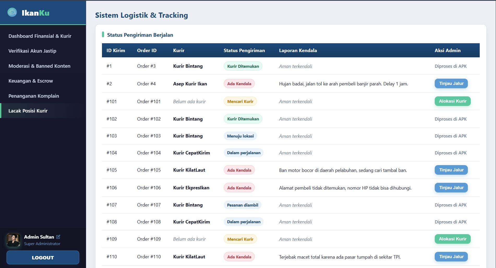
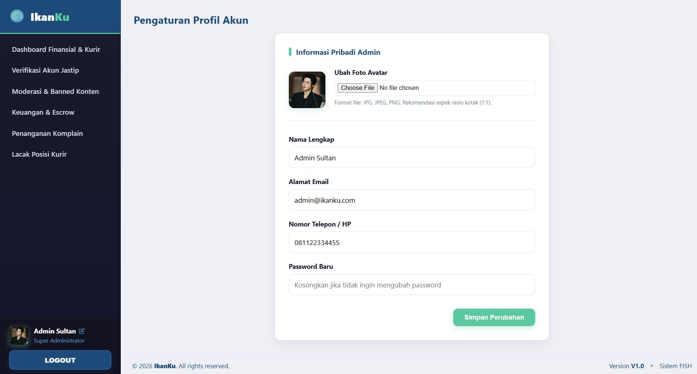

# IKANKU - Platform Jasa Titip Hasil Laut

**Platform Informasi Harga dan Jasa Titip Hasil Laut Berbasis User-Centered Design**

---

## Daftar Isi

- [Tentang Proyek](#tentang-proyek)
- [Latar Belakang](#latar-belakang)
- [Permasalahan yang Diselesaikan](#permasalahan-yang-diselesaikan)
- [Fitur Utama](#fitur-utama)
- [Screenshot](#screenshot)
- [Tim Pengembang](#tim-pengembang)

---

## Tentang Proyek

**IKANKU** adalah platform multi-platform (Website Admin & Mobile App) yang menghubungkan konsumen urban dengan hasil tangkapan laut segar dari Muara Karang melalui sistem Jasa Titip (Jastip) yang terverifikasi. Platform ini dikembangkan menggunakan pendekatan **User-Centered Design (UCD)** untuk memastikan antarmuka yang inklusif dan mudah digunakan.

### Tujuan Proyek

1. **Transparansi Harga** - Menyediakan informasi harga ikan real-time yang akurat dan mudah diakses
2. **Akses Produk Segar** - Memfasilitasi jasa titip dari Muara Karang untuk konsumen urban yang sibuk
3. **Edukasi Konsumen** - Memberikan panduan memilih dan membedakan jenis ikan segar

---

## Latar Belakang

Indonesia memiliki potensi maritim yang sangat besar dengan garis pantai terpanjang kedua di dunia (99.083 km), namun:

- **Rantai distribusi panjang**: Nelayan → Pengepul → Pedagang → Konsumen
- **Ketimpangan margin**: Nelayan dapat porsi keuntungan terkecil
- **Kesejahteraan rendah**: Rata-rata pendapatan nelayan hanya Rp 3.480.000/bulan
- **Resistensi digitalisasi**: Pedagang grosir menolak platform e-commerce konvensional

### Pivot Konsep

Platform awalnya dirancang sebagai marketplace-fintech masif, namun setelah riset lapangan di **Pasar Modern Muara Angke** dan **Kawasan Pesisir Muara Karang**, tim melakukan pivot ke model **Jasa Titip (Crowdsourced Delivery)** karena:

1. Tidak mengganggu ekosistem transaksi tradisional yang sudah berjalan
2. Mengatasi karakteristik produk laut yang mudah rusak
3. Mempertahankan sistem verifikasi berbasis kepercayaan (video call/foto)
4. Efektif memotong rantai distribusi tanpa memaksa digitalisasi penuh

---

## Permasalahan yang Diselesaikan

### 1. Ketidaktransparanan Harga
- **Masalah**: Konsumen tidak punya acuan harga wajar, rentan manipulasi
- **Solusi**: Grafik tren harga pasar harian per jenis ikan

### 2. Akses Produk Segar Terbatas
- **Masalah**: Jarak jauh, macet, waktu operasional pasar subuh
- **Solusi**: Sistem Jastip terverifikasi dengan live streaming dari pasar

### 3. Kurangnya Edukasi
- **Masalah**: Konsumen sulit membedakan ikan segar vs diawetkan
- **Solusi**: Direktori karakteristik fisik spesies ikan & tips kesegaran

---

## Fitur Utama

### Untuk Pembeli (User App)

| Fitur | Deskripsi |
|-------|-----------|
| Registrasi & Login | Autentikasi aman dengan validasi email |
| Live Streaming | Menonton jastiper live dari pasar real-time |
| Chat Real-Time | Komunikasi langsung dengan filter kata kasar otomatis |
| Katalog Ikan | Browse produk dengan detail harga & informasi kesegaran |
| Checkout Otomatis | Kalkulasi otomatis (Harga + Ongkir + Fee Jastip) |
| Escrow Payment | Dana ditahan sistem hingga barang diterima |
| Lacak Pesanan | Live tracking kurir dengan peta real-time |
| WavePay Wallet | E-wallet internal dengan top-up & riwayat transaksi |
| Notifikasi | Update status pesanan real-time |

### Untuk Jastiper (Jastip User App)

| Fitur | Deskripsi |
|-------|-----------|
| Pendaftaran Jastiper | Verifikasi identitas & dokumen oleh admin |
| Start Live Session | Streaming langsung dari lokasi pasar |
| Pin Produk Unggulan | Highlight produk pilihan saat live |
| Kelola Etalase | Manajemen katalog produk dengan foto & harga |
| Respon Order | Konfirmasi/tolak pesanan dengan verifikasi barang |
| Serah Terima | Validasi kode pesanan ke kurir dengan foto bukti |
| Dashboard Pendapatan | Laporan keuangan & penarikan saldo |

### Untuk Admin (Web Dashboard)

| Fitur | Deskripsi |
|-------|-----------|
| Verifikasi Akun Jastip | Review & approve pendaftaran jastiper |
| Moderasi Konten | Take down live, banned user melanggar |
| Keuangan & Escrow | Monitoring dana, approve penarikan saldo |
| Handle Komplain | Mediasi dispute & pengembalian dana |
| Logistik & Tracking | Manajemen kurir & monitoring pengiriman |
| Dashboard Analitik | Statistik transaksi & performa platform |

---

## Screenshot

### Admin Web Dashboard

<table>
<tr>
<td width="50%">

 <b>Login Admin</b>
</td>
<td width="50%">

 <b>Dashboard Home</b>
</td>
</tr>
<tr>
<td width="50%">

 <b>Verifikasi Akun Jastip</b>
</td>
<td width="50%">

 <b>Moderasi dan Banned Konten</b>
</td>
</tr>
<tr>
<td width="50%">

 <b>Keuangan & Escrow</b>
</td>
<td width="50%">

 <b>Penanganan Komplain</b>
</td>
</tr>
<tr>
<td width="50%">

 <b>Lacak Posisi Kurir</b>
</td>
<td width="50%">

 <b>Profile Admin</b>
</td>
</tr>
</table>

---

### Mobile App (User & Jastiper)

<table>
<tr>
<td width="50%">

 <b>Design Prototype Figma 1</b>
</td>
<td width="50%">

 <b>Design Prototype Figma 2</b>
</td>
</tr>
</table>

*High-fidelity interactive prototype untuk aplikasi mobile user dan jastiper*

---

## Tim Pengembang

Proyek ini dikembangkan sebagai Ujian Akhir Semester (UAS) Mata Kuliah **Interaksi Manusia & Komputer** - TIF18 4PTI1

| NIM | Nama | Role |
|-----|------|------|
| 32240155 | Febriani Adeline | UI/UX Designer & Researcher |
| 32240119 | **Gwyneth Eunice Widjaja** | Mobile Developer & System Analyst |
| 32240127 | Corinthia Angie | Database Designer & Backend |
| 32240144 | Chelsea Arlyn | Frontend Developer & Tester |

**Dosen Pengampu**: Jusia Amanda Ginting, S.Kom., M.Kom

**Institusi**: Universitas Bunda Mulia - Fakultas Teknologi dan Desain

---

## Dokumentasi Lengkap

Untuk dokumentasi lengkap, lihat:
- **Laporan IMK.md** - Laporan lengkap proyek (96 halaman)
- **Laporan IMK.pdf** - Versi PDF untuk presentasi

---

## Lisensi

Project ini dikembangkan untuk keperluan akademik. Hak cipta dilindungi © 2025 Tim IKANKU - Universitas Bunda Mulia

---

**Bersama IKANKU, Ikan Segar Langsung ke Tangan Anda**

Made with love by Tim IKANKU - Universitas Bunda Mulia

